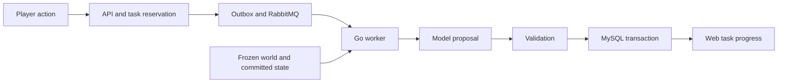

# AI Novel Studio · AI 小说创作台

An AI novel generation platform with world building, interactive choices, and persistent character state.

[简体中文](README.zh-CN.md) · [Architecture](docs/architecture.md) · [Run the web app](docs/development.md)

AI Novel Studio is an AI interactive fiction application built with Next.js and Go. Create a world, start a private journey, and choose what happens next. The server checks a model's proposed changes before committing them to the story.

For developers building narrative games or stateful AI applications, the useful part is the boundary between generated prose and stored facts: a model can propose an action, but it cannot rename an established character through a state patch.

## See a valid turn commit and an invalid change fail

With Go 1.26 or newer, from the repository root:

```sh
cd services/server
go run ./cmd/demo
```

The demo uses the actual story engine with an in-memory repository and a deterministic fake provider. It needs no API key, database or Docker. Go may download module metadata on first use.

It commits a harbor scene, attempts to change a character's name, then checks that the rejected proposal leaves the committed version intact. This demonstrates validation behavior; it does not measure a real model's storytelling quality.

## What is included

| Part | What you can inspect |
| --- | --- |
| Web application | World discovery, authoring, private journeys, account flows and task progress |
| Story engine | Frozen world snapshots, committed context, character and scene validation |
| Go API and worker | Queued generation, model proposals, validation and transactional persistence |
| Data and contracts | MySQL migrations, synthetic development data and an OpenAPI client |
| Model integration | OpenAI-compatible requests, configurable endpoints and fallback handling |

The public edition includes synthetic development content. It excludes the hosted site's catalog, original cover artwork, user data and production configuration. Payment-related code does not establish a live payment integration.

## How a turn reaches the story



The [architecture guide](docs/architecture.md) connects each decision to its implementation and tests. The standalone demo uses an in-memory commit path; the full application uses the worker and database path.

## Development

Node.js 22+ is required for the web application. From the repository root:

```sh
npm ci
npm run build:api-client
npm run test:web
npm run test:api-client
npm run tokens:check
```

For the Go packages:

```sh
cd services/server
go test ./...
```

Database, Redis, RabbitMQ and live-model integration tests require their explicit test environment variables. A default `go test` run does not prove those integrations work. Read [development setup](docs/development.md) and the [verification record](docs/verification.md) before starting the full application.

## Contribute

Useful contributions include a reproducible continuity failure, a focused validator regression test, or a clearer first-run instruction. Include the action, expected state and actual result; use synthetic data and remove credentials. See [contributing](CONTRIBUTING.md) and [security reporting](SECURITY.md).

If you use these patterns in a story project, a star helps other developers find the implementation.

## License

[MIT](LICENSE). Dependency licenses remain applicable; see [third-party notices](THIRD_PARTY_NOTICES.md).
